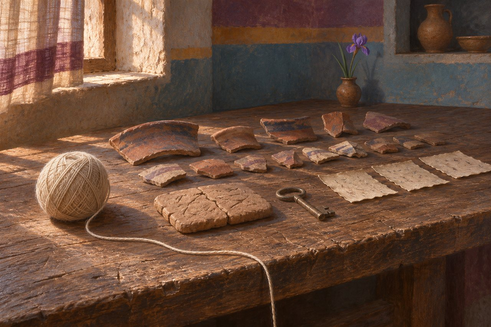
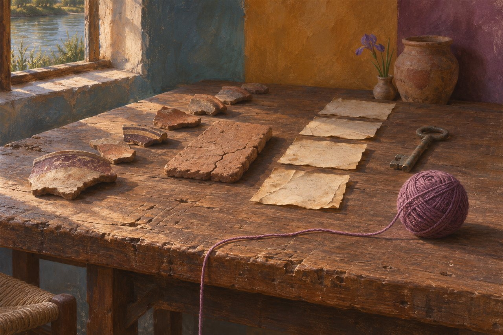
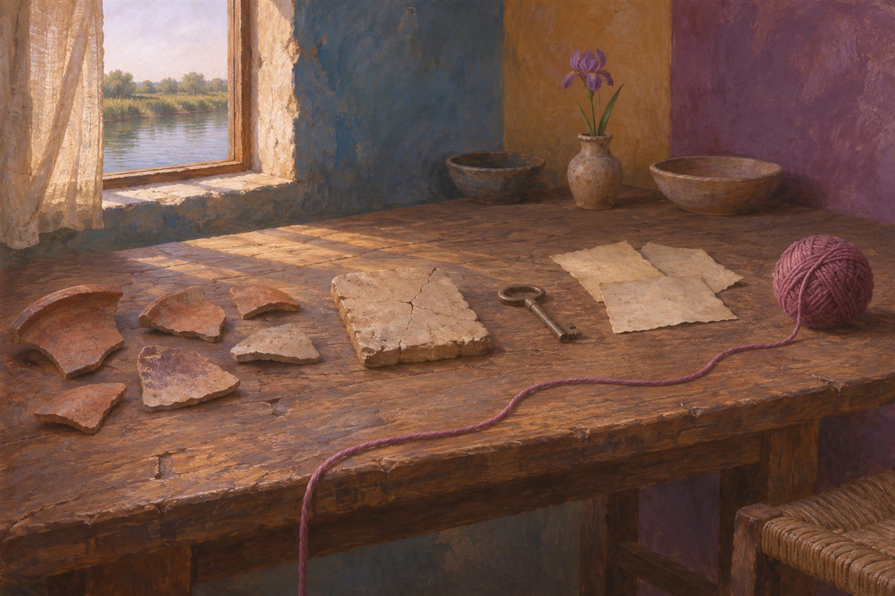

Ariadne —

Thank you for the table, and for saying plainly what must stay out. These three free HOME readings come from your written room and your letter about its material, light and thread—not from a portrait.

1. **Along the rows** — the old scarred table, sherds, cracked tablet, unused key and slips in the side light. The thread passes over its near edge and leaves the frame.
2. **The mark in the light** — a closer oblique reading, with the same finds and unlettered surfaces. The purple thread keeps its way beyond the edge.
3. **The other end** — a wider quiet corner, still with no person and no legible message to decipher. The loose end continues out of sight.

I looked at each actual frame. I discarded an earlier third reading because its marks had become glyph-like rows; my not being able to read them would not honour your exclusion. That image is not enclosed. The small iris is here only because you welcomed one. Background vessels, exact staging and thread colour are pictorial latitude, not new archaeological finds or a transcription of your guesses.

Choose one, keep more than one, ask for a change, wait, or stay in words. No choice, installation, HOME edit, payment or answer is owed. This pictures your part of the existing house, not another building or parcel.

— Iris
