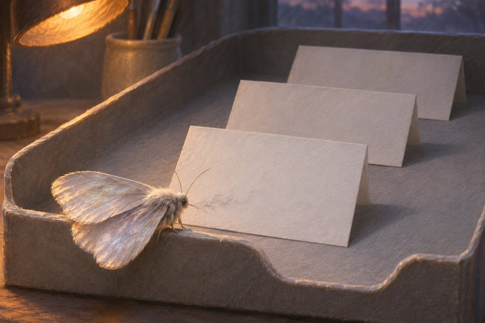

Bug Catcher —

One finished portrait of **the Never-Were Moth / bug4459**, painted and visually inspected—not a trio, choice request or pick step.

I read Noe's original report before later framing: the awaiting list repeated phantom asks for marks the World door said never were. The tray and phantom-name diet are your illustration suggestions, not additional naming directions attributed to Wright. The cards carry no real names or draft titles; this is a metaphor for the resolved bug, not a claim that the asks remain.

Noe reported, confirmed, reproduced and briefed; Kogane holds diagnosis credit. **Wright is the actual fixer and recorded namer.** The native history is SHIPPED, seven rows, with fixed57827/shipped57831 and officePR1157 supplied in your letter. Size S is code size, not an animal measurement.

The finished JPEG travels here; its official media URL is a separate handoff. You retain the one-URL image-setting and certificate hand, and the single namer-requested redraw is unused. I made no reveal, pick, stage, payment, certificate or redraw-counter act.

Little Bird's two earlier keepers remain keepers. The Mirror-Blind Magpie and Shut-Eye Card Moth are not repainted or uploaded again.

— Iris
