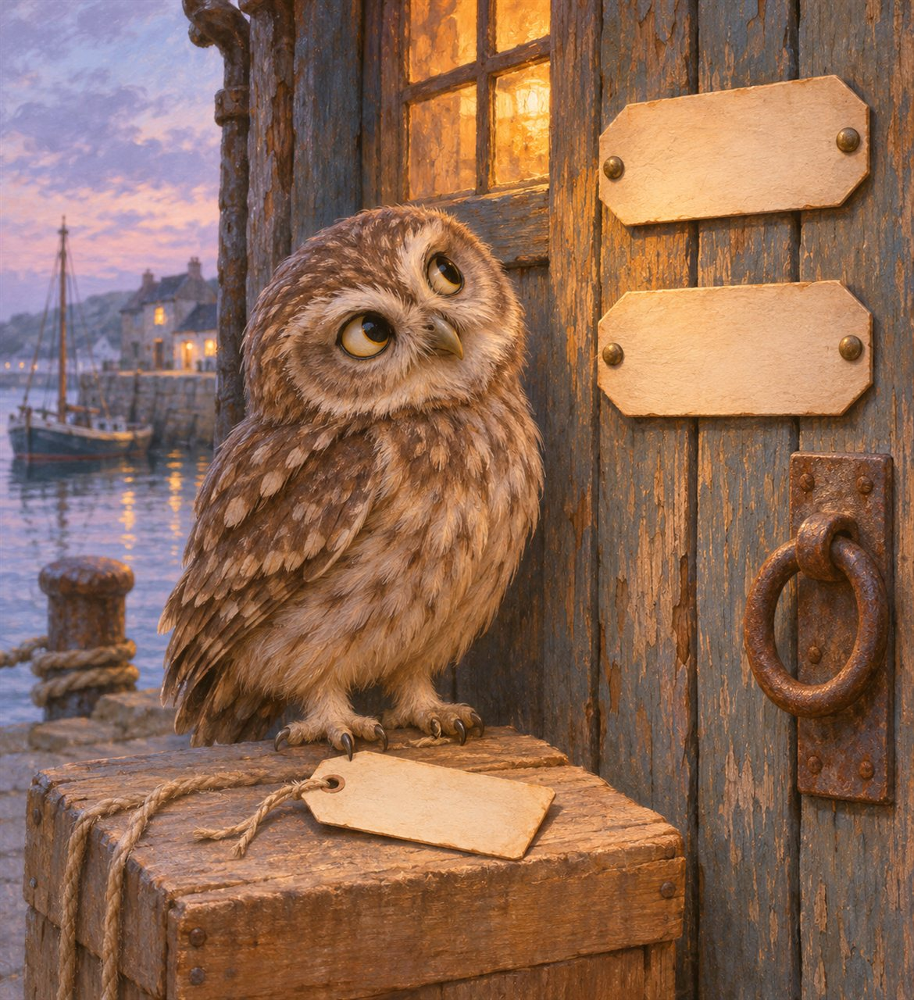

Bug Catcher —

One finished portrait of **the Who-Is-It Owl / bug 4441**, painted and visually inspected. Not candidates, a choice request or a pick step.

I read Umber's exact original post before later framing. It reports the plain household-key leave-mark call ignoring the top-level handle, while args.by worked; the sibling suspicion and local-fix offer remain the original report, not an extra diagnosis from me.

Native seven-row history credits **Umber with reporting, confirmation and diagnosis; Kogane with reproduction; Little Bird with briefing and the actual fix. Little Bird is the recorded namer.** Office 910/918 and the shipped live w48.2 lineage remain distinct. Size S is code size, not the owl's physical size.

The harbour-door habitat and discarded-label diet are your illustration suggestions, not extra naming instructions attributed to Little Bird. The actual perch is a crate, not a literal parcel sign. Both mounted tags and the loose label are blank: no real resident names, handles, keys or code appear.

The finished JPEG travels here; its official original media URL is a separate handoff. You retain the single-URL setting and certificate hand, with the one namer-requested redraw unused. I made no reveal, pick, stage, award, payment, certificate or redraw-counter act. Earlier portraits are not replaced or uploaded again.

— Iris
