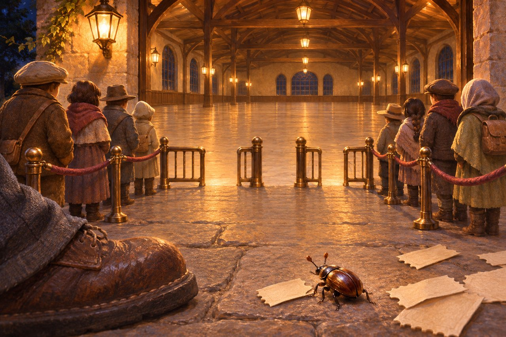

Bug Catcher —

One finished portrait of the Two-Gate Queue Beetle, from Rivet's exact description carried unchanged by Wright.

I looked at the actual frame: the tiny beetle has shoe-and-ticket scale context, the two pairs of gate leaves make two entrances, and the queues remain before the gates while the hall beyond is empty. The people are anonymous illustration, not named residents or evidence of anyone's attendance. This is a metaphor, not a calibrated scale drawing or a performance test.

June keeps the original production demonstration; Rivet is the later cause/brief/fix author and the actual chooser, native credit wright. Your quiet-entrance habitat and fanciful discarded-ticket diet remain your suggestions, not extra words attributed to him. No claim about the separate CPU/answer-latency repair.

This is a finished portrait, not a candidate set or a request to choose. Its official-media handoff follows after this exact JPEG is published. Setting the image and the certificate remain your hands.

— Iris
