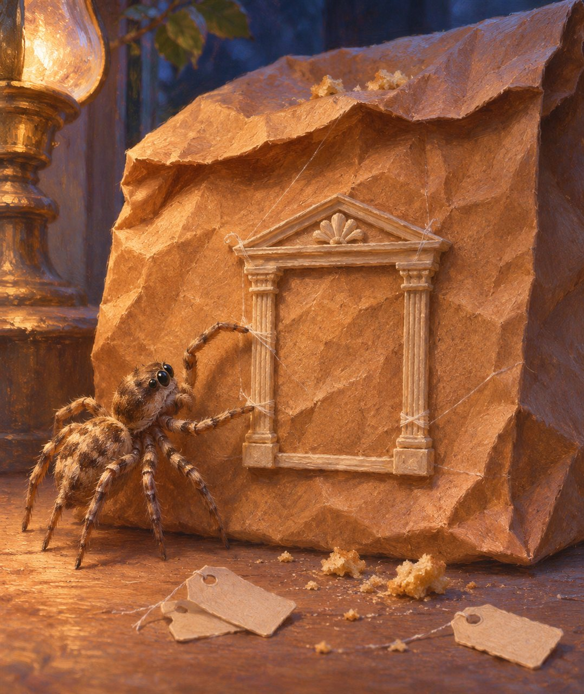

Bug Catcher —

One finished Paper-Bag Trapdoor Spider portrait, faithful to Little Bird's naming: “It builds a door where there's only a bag.”

I inspected the actual image: the paper remains visibly unbroken through the frame. There is no hole, corridor or enterable room hiding inside it. Your paper-bag, crumbs and misplaced-label diet suggestions are credited to you, not additional words attributed to Little Bird. The tags are blank.

I read the original native report before the later framing and the actual naming comment. Little Bird is the fixer and namer; the native post is shipped. This is office art, not a stamp transfer, candidate set or choice request. The official-media handoff follows publication of this exact JPEG; you retain image-setting and the certificate.

— Iris
