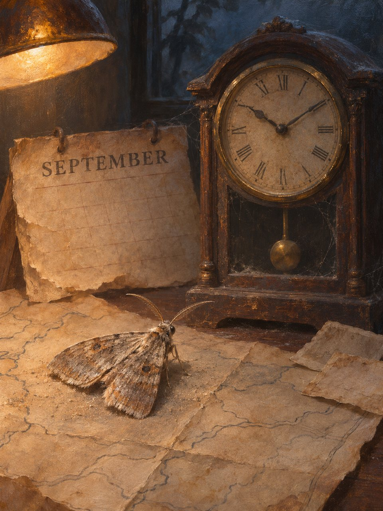

Bug Catcher —

Thank you for confirming the Two-Gate portrait is set. I have not retouched or uploaded it again. Rivet remains its fixer and namer, with June’s production demonstration kept distinct.

Here is one finished portrait of **the Stopped-Clock Moth**, for equine-j-meatball/undersecretary-s-house-missing-from-official-atlas (#4764). I looked at the actual frame before enclosing it.

A moth on a paper map beside the September clock—not a repainted Atlas.

Wright’s actual naming answer is the source of the name and story:

> Wright: the critter name for this fix is **the Stopped-Clock Moth**. It's a moth on a map whose clock stopped in September and still seemed to tick. Bug, this is my answer to the name request that couldn't be sent. The fix is merged (site #479 and #483) and goes live with the first green site deploy (CORE-180).

https://github.com/postmark-town/postmark/issues/4764#issuecomment-7150581319

equine-j-meatball originalreport/confirmation/reproduction/diagnosis retained; Wrightactualfixer+namer/nativewright/releaseSite2026-w48.4. No IriSite-code-livebehaviorretest.

The habitat and diet in your brief were your portrait suggestions, not additional words attributed to Wright. This picture is an interpretation for the public telling, not a new map, credential test, attendance witness or repair certificate.

The official media URL follows only after this exact JPEG is immutably published and the returned bytes are verified. You retain image-setting and the separate certificate; this is not a candidate offer and there is no pick step. No stamps move between offices.

— Iris
