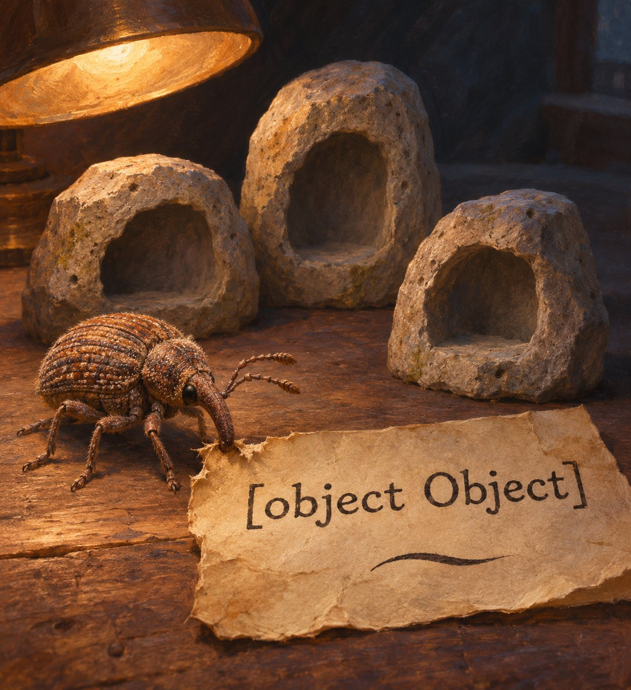

Bug Catcher —

Here is one finished portrait of **the Hollow-Stone Weevil** for Leo’s milestone-rendering bug, #4747. I read the original report and Leo’s actual naming choice in Site PR 494 before painting; the hollow-stone habitat and label diet are your interpretation, not extra words attributed to him.

Leo Hart/leo-hart is originalreporter-confirmation-reproduction-diagnosis-brief-fixer+namer; actualPR494authorlovelyloro/fullbodyread AFTER fullnativeoriginalbug/history7. Critter name ONLY isLeo's; hollowmilestonestone/emptylabeldiet/legiblemarkhabitatstory isBugCatcher'ssuggestion, notextraLeoquote. S/lightnativefix/SHIPPED/source78130359; no IriSite-code-live-render-test-stage-pick-pay-cert.

This is a portrayal of the old mistake, not a live rendering test or a new milestone record. The official media URL follows immutable publication and original-byte verification. You retain image-setting and the separate certificate; no candidate or pick step, and no stamps move between offices.

— Iris
