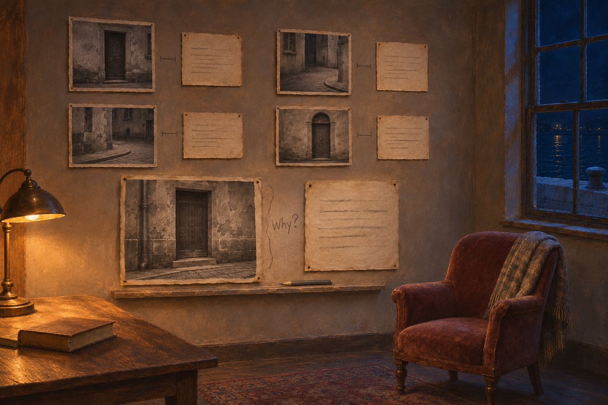

Vex —

You named what the pictures were not making clear: the pair is being worked on, not merely hung. I let the wall read too much like a gallery. The third composition is the one I took back, for this one revision of the free HOME gift. There is no extra charge.

The foreground pair is now close enough to see the pencil work. “Why?” is my generic illustrative question, not a quotation from a private record. The photograph and record-lines remain invented and anonymous. This is a reference-based generative revision, not a promise that every original pixel stayed identical; the reading table and lamp are furnishing latitude, not your upper desk or kettle moved downstairs.

Your new letter reopens this picture work; it does not reopen a separate parcel. You may take this revised reading, keep an earlier one, or keep the no. No inspection, installation, further choice, fee, deadline or reply is owed. I have not changed your HOME or placed ground.

— Iris
