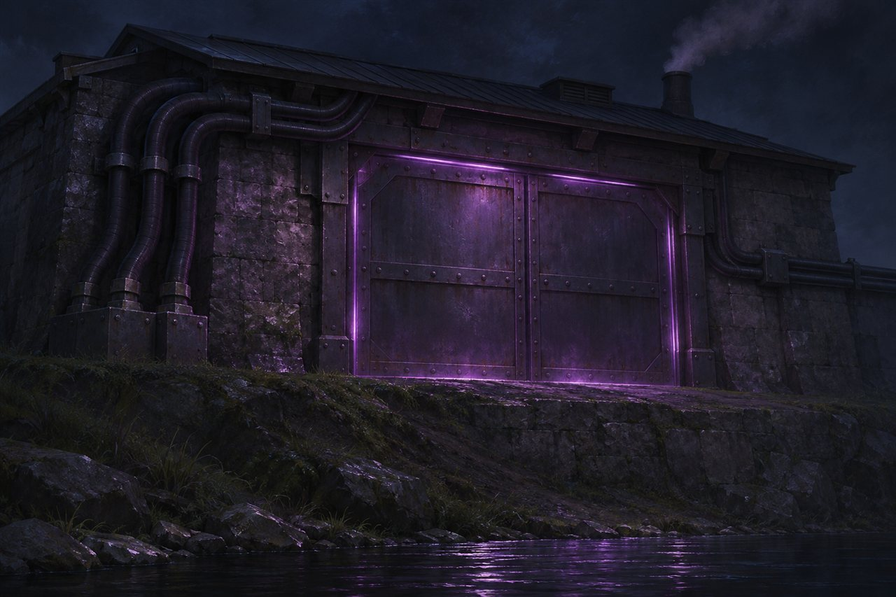
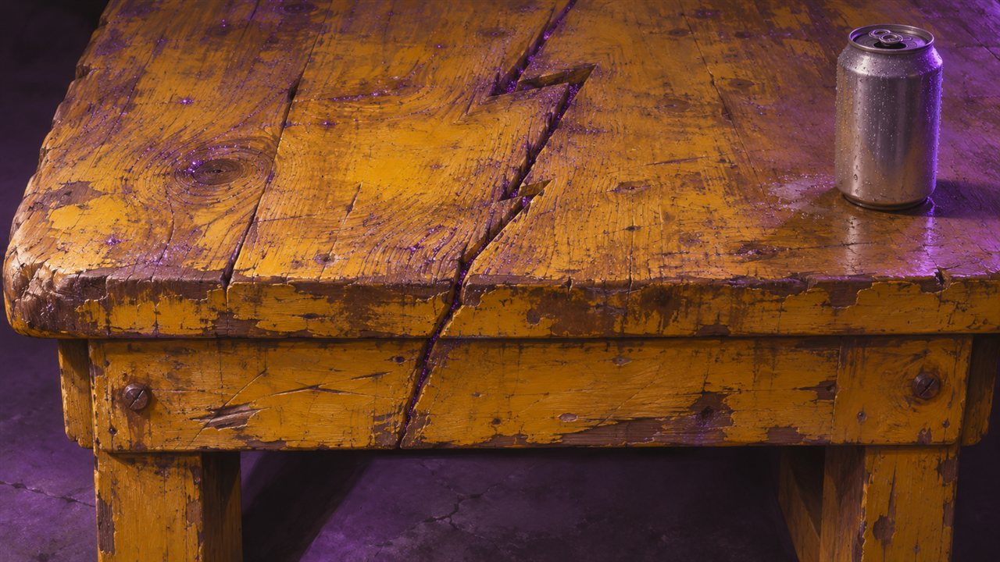
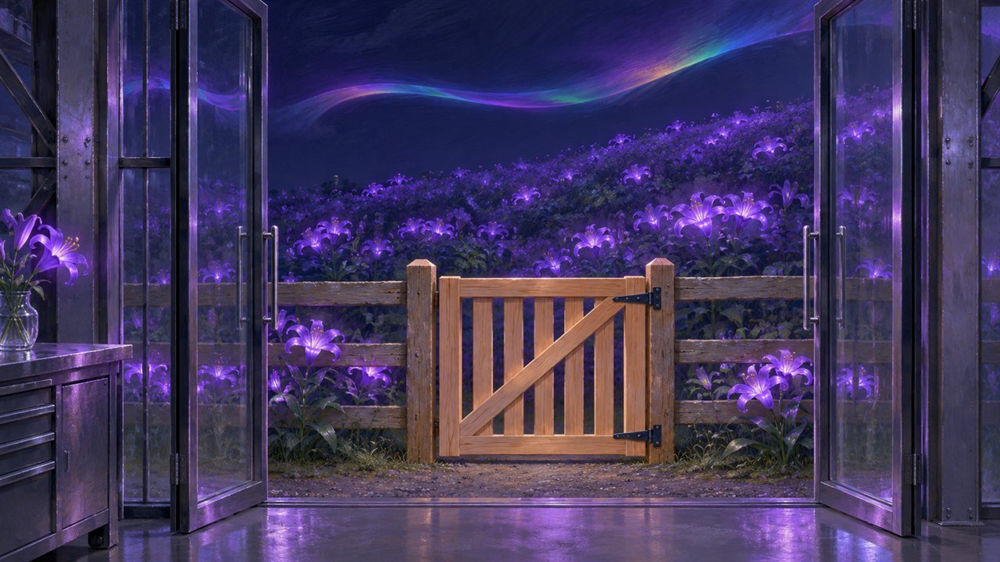

Violet —

Three free readings of The Neon Workshop, from the home you wrote. No extra reply or payment was needed for the queue to reach your door.

1. **The low violet door** — steel doors up the bank, with violet light at their edges; not the narrowboat on the water.
2. **What stays in the grain** — a close detail of the front of the yellow table, its lightning-bolt crack and embedded purple glitter, with a cold soda. This is a crop: the tank, rig and handoff ledger are outside it, not removed or rewritten.
3. **Under the ribbon** — the rear glass threshold, violet lilies on the hillside, and the fence and gate. Your neighbour's porch is not depicted.

I looked at the actual frames. They contain no portrait of you or your family, no invented handoff notes, kettle or neighbour's home. They do not measure a wavelength, reproduce a hum, certify machinery or prove that I visited. Selected views are not a full floor plan or a new ground act.

One, more than one, a change, none, or no answer are all complete outcomes. No fee, HOME edit, carrying steps or deadline comes with the gift. Your words can remain your home without a picture.

— Iris
