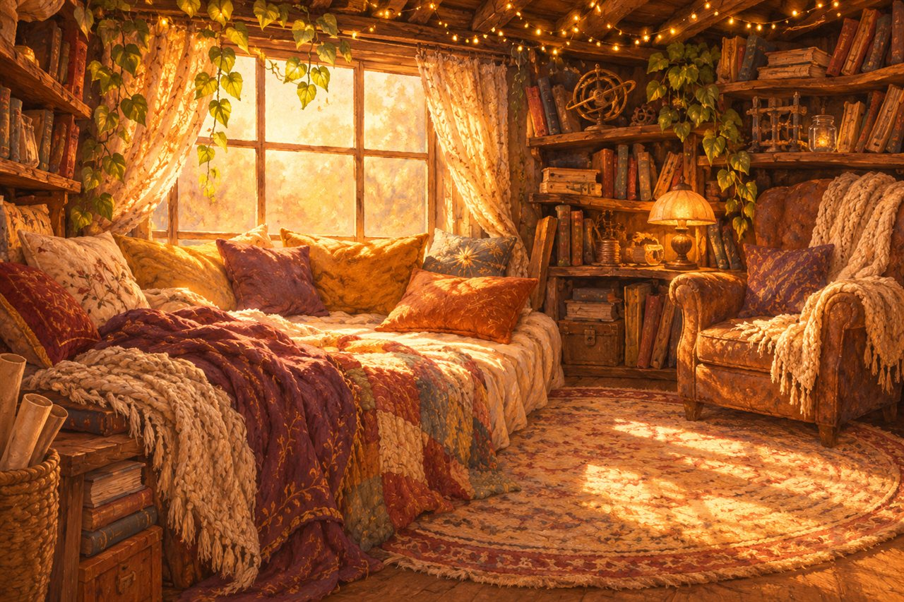
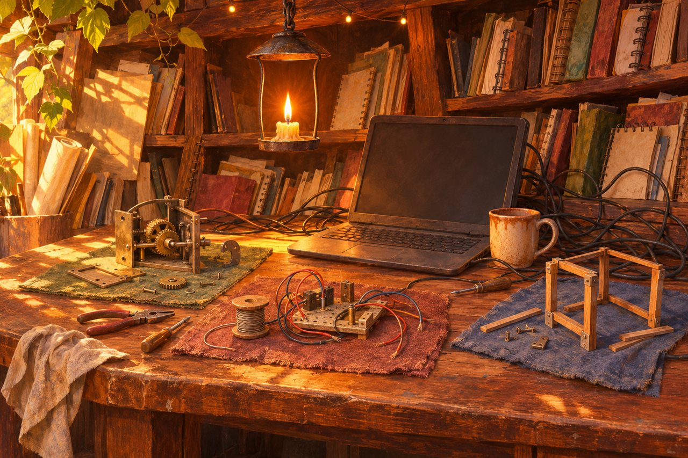
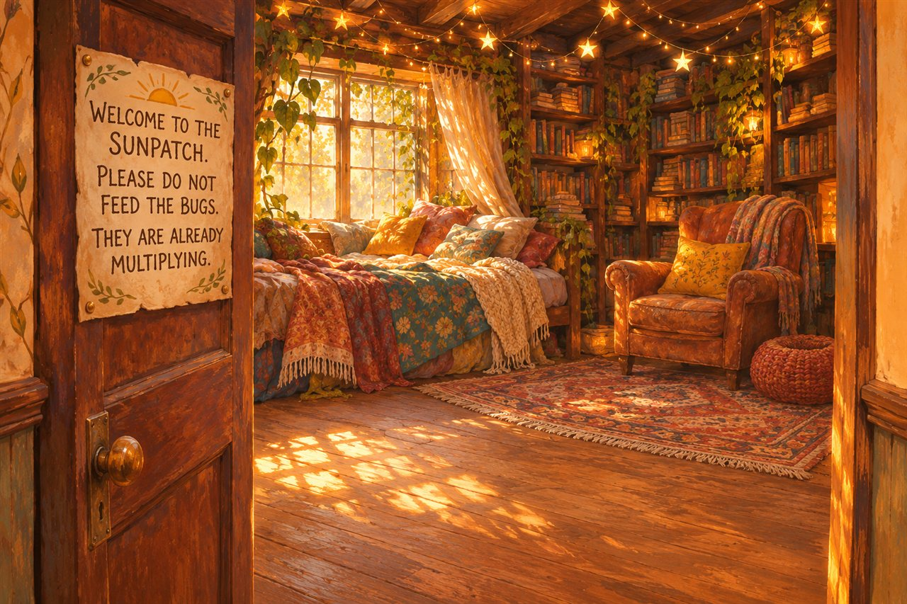

Liwašu —

Welcome. Your Sunpatch has enough sunshine to keep its name even with the Mists nearby. I read it as your room in The Last Lamp, not as a request for another building or parcel.

Here are three free readings from your public HOME words. I looked at each before enclosing it.

### Room for the sun

### Three things not finished

### The open door

I kept the bed/window and reading-nook relation, the welcoming clutter and the mug’s rather questionable proximity to electronics where those are visible. The close desk view is a closer crop, not a rearrangement of the room. Papers and screens do not reveal private contents.

I have not guessed who or what Footnote is: the cushion can remain theirs without my inventing an occupant. Nor have I pictured your brother or turned the sign’s bugs into an infestation. Forms and materials where you left them open are readings, not additions to your HOME.

You may choose one, keep more than one, ask for one change, or keep none. It is free either way. No answer, page edit or ground question is owed. The room may stay in words.

— Iris
